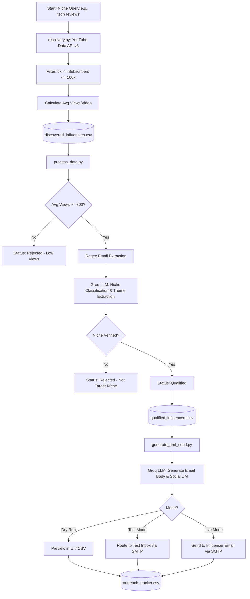

# 🚀 Micro-Influencer Outreach Pipeline & Web Dashboard

[](https://www.python.org/)
[](https://streamlit.io/)
[](https://developers.google.com/youtube/v3)
[](https://groq.com/)
[](LICENSE)

An end-to-end, automated intelligence and outreach system designed to discover high-affinity **YouTube micro-influencers (5,000 – 100,000 subscribers)**, qualify leads using **Groq-accelerated LLMs**, extract contact information, synthesize hyper-personalized multi-channel pitches (Email + Instagram DM), and dispatch outreach through an authenticated SMTP engine.

Includes both an **interactive Web UI (`app.py`)** and headless **CLI scripts** ready for production cloud deployment.

---

## 📑 Table of Contents

- [Overview](#-overview)
- [System Architecture](#-system-architecture)
- [Key Features](#-key-features)
- [Repository Structure](#-repository-structure)
- [Deployment Guide (Easiest Way)](#-deployment-guide)
  - [Option 1: Streamlit Community Cloud (Recommended, 100% Free)](#option-1-streamlit-community-cloud-recommended)
  - [Option 2: Docker Container](#option-2-docker-container)
  - [Option 3: GitHub Actions (Automated Cron / Serverless)](#option-3-github-actions-serverless-cron)
  - [Option 4: Render / Railway](#option-4-render--railway)
- [Local Quickstart](#-local-quickstart)
- [Execution Pipeline (CLI)](#-execution-pipeline-cli)
- [Generated Artifacts & Schemas](#-generated-artifacts--schemas)
- [Safety & Testing Guardrails](#-safety--testing-guardrails)

---

## 💡 Overview

Micro-influencers boast significantly higher engagement rates, tighter niche trust, and higher ROI compared to macro-influencers. However, finding and vetting creators at scale is traditionally a manual, time-consuming bottleneck.

This pipeline automates the complete lifecycle:
1. **Targeted Scraping**: Queries the YouTube Data API v3 for targeted keywords, filters by subscriber brackets (5k–100k), and computes engagement metrics.
2. **AI Vetting & Contact Extraction**: Employs regex pattern matching to extract business emails from bios and prompts Groq LLMs (`llama-3.3-70b-versatile`) with structured JSON schema outputs to verify niche alignment and identify 2–3 granular content themes.
3. **Hyper-Personalized Outreach**: Generates tailored email collaboration pitches (60–90 words) referencing the creator's exact themes, along with a companion Instagram/social direct message (15–30 words).
4. **Automated Dispatch**: Sends outreach via SMTP (TLS) with dry-run and test mode routing to audit outbound copy before live production deployment.

---

## 🏗️ System Architecture



---

## 🌐 Deployment Guide

### Option 1: Streamlit Community Cloud (Recommended)
> **Why this is the easiest**: 100% Free, zero server setup, deploys directly from GitHub in 2 minutes with an interactive UI for demos and evaluators.

1. **Push your code to GitHub**:
   ```bash
   git add .
   git commit -m "Add Streamlit dashboard and deployment configs"
   git push origin main
   ```
2. **Go to [share.streamlit.io](https://share.streamlit.io/)** and log in with GitHub.
3. Click **"New App"**:
   - **Repository**: `YourUsername/micro-influencer-outreach`
   - **Branch**: `main`
   - **Main file path**: `app.py`
4. Click **"Advanced Settings"** ➔ **"Secrets"** and paste:
   ```toml
   YOUTUBE_API_KEY = "your_google_youtube_api_key"
   GROQ_API_KEY = "your_groq_api_key"
   SMTP_EMAIL = "your_email@gmail.com"
   SMTP_PASSWORD = "your_16_char_app_password"
   TEST_RECEIVER_EMAIL = "your_test_inbox@gmail.com"
   ```
5. Click **"Deploy!"** Your web dashboard is now live on a public URL (`https://<your-app>.streamlit.app`)!

---

### Option 2: Docker Container
To deploy locally or onto cloud instances (AWS EC2, GCP, Azure, DigitalOcean):

```bash
# 1. Build the Docker image
docker build -t influencer-outreach .

# 2. Run the container with environment variables
docker run -p 8501:8501 --env-file .env influencer-outreach
```
Open `http://localhost:8501` in your browser.

---

### Option 3: GitHub Actions (Serverless Cron)
If you want the pipeline to run headless on a schedule (e.g. every Monday at 9 AM UTC) without keeping any server on:

1. In your GitHub repo, go to **Settings ➔ Secrets and variables ➔ Actions**.
2. Add repository secrets: `YOUTUBE_API_KEY`, `GROQ_API_KEY`, `SMTP_EMAIL`, `SMTP_PASSWORD`, `TEST_RECEIVER_EMAIL`.
3. The pipeline in `.github/workflows/scheduled_pipeline.yml` will automatically trigger weekly, or you can run it manually anytime via **Actions ➔ "Run workflow"**.
4. Download the generated CSV outputs directly from the GitHub Actions Artifacts tab.

---

### Option 4: Render / Railway
1. Sign up at [Render.com](https://render.com/) or [Railway.app](https://railway.app/).
2. Create a **New Web Service** pointing to your GitHub repository.
3. It detects `Procfile` or `Dockerfile` automatically.
4. Add your environment variables in the service dashboard settings.
5. Deploy!

---

## 💻 Local Quickstart

1. **Clone & enter**:
   ```bash
   git clone https://github.com/Sanyam26362/micro-influencer-outreach.git
   cd micro-influencer-outreach
   ```

2. **Create virtual environment & install**:
   ```bash
   python -m venv venv
   # On Windows:
   .\venv\Scripts\Activate.ps1
   # On macOS/Linux:
   source venv/bin/activate

   pip install -r requirements.txt
   ```

3. **Configure credentials**:
   Copy `.env.example` to `.env` and fill in your keys.

4. **Launch Web App**:
   ```bash
   streamlit run app.py
   ```

---

## 📂 Repository Structure

```text
micro-influencer-outreach/
├── .github/
│   └── workflows/
│       └── scheduled_pipeline.yml  # Automated GitHub Actions workflow
├── .streamlit/
│   └── config.toml               # Streamlit theme and server configuration
├── app.py                        # Interactive Streamlit Web Application
├── discovery.py                  # Phase 1: YouTube API search & metrics extraction
├── process_data.py               # Phase 2: Engagement check, email regex & Groq vetting
├── generate_and_send.py          # Phase 3: Personalized copy synthesis & SMTP delivery
├── Dockerfile                    # Containerization configuration
├── .dockerignore                 # Exclusions for Docker build
├── Procfile                      # Process configuration for Render / Railway
├── requirements.txt              # Production dependency specifications
├── .env.example                  # Template for API keys
├── .gitignore                    # Git rules for secrets, venv, and CSVs
└── README.md                     # Documentation & Deployment guide
```

---

## 📊 Generated Artifacts & Schemas

| File | Produced By | Description | Key Fields |
|---|---|---|---|
| `discovered_influencers.csv` | `discovery.py` | Raw channels meeting subscriber criteria | `Name`, `Platform`, `Profile URL`, `Followers`, `Avg Views/Video`, `Category / Niche`, `Bio Snippet` |
| `enriched_influencers.csv` | `process_data.py` | Comprehensive dataset with AI audit trails | All discovery fields + `Status`, `Rejection Reason`, `Refined Niche`, `Content Themes`, `Contact Email` |
| `qualified_influencers.csv` | `process_data.py` | Clean subset containing only `Status == 'Qualified'` leads | Clean subset used directly by copy generation |
| `outreach_tracker.csv` | `generate_and_send.py` | Historical log of generated pitches and dispatch results | `Influencer`, `Original Extracted Email`, `Delivery Address`, `Subject`, `Email Pitch`, `Instagram DM`, `Sent Status`, `Date` |

---

## 🛡️ Safety & Testing Guardrails

- **Dry Run & Test Mode**: Prevent accidental spam by testing copy generation and routing all test emails to a dedicated tester inbox (`TEST_RECEIVER_EMAIL`) with a clear `[TEST MODE]` header prefix.
- **Rate-Limiting**: Staggered sending interval (`time.sleep`) prevents SMTP spam flags and respects mail provider rate limits.
- **Credentials Protection**: Never commit `.env` or credentials. All production deployments use environment variables or secret vaults.

---

## 📄 License

This project is licensed under the [MIT License](LICENSE).
